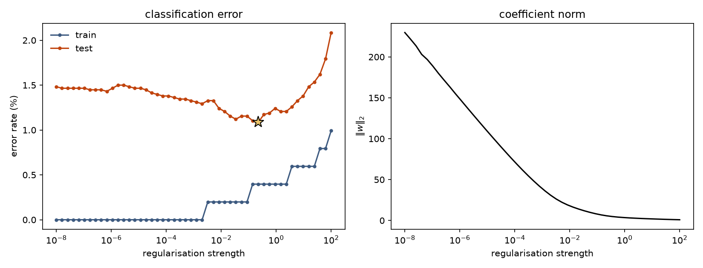
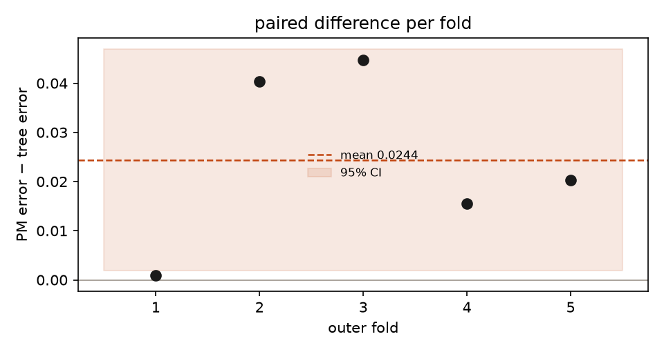

::: {.panel-tabset}

## Article

The dataset is 6,497 wines described by eleven chemical measurements — fixed and volatile
acidity, citric acid, residual sugar, chlorides, free and total sulphur dioxide, density,
pH, sulphates and alcohol — with a binary label for red and white. A classifier that
separates them scores above 99%. That is the point of using it: the question is not whether
a model fits, but where the fitting stops being honest.

```{=html}
<figure>
  
  <figcaption>Left: training and test error across fifty values of the regularisation
  strength. Right: the L2 norm of the coefficient vector over the same sweep.</figcaption>
</figure>
```

## Regularisation

Training error sits at zero across four orders of magnitude of regularisation and only
lifts above 0.1% once $\lambda$ passes $10^{-2}$. Test error is flat and close to 1.4%
until roughly $\lambda = 10^{-3}$, then descends to a minimum of **1.09% at
$\lambda = 0.222$**, then climbs steeply to 2.1% at $\lambda = 100$.

The coefficient norm falls monotonically from 229.8 to 0.904 over the same sweep. The two
panels are the same story from two directions: the model does not need much freedom to
separate these wines, and giving it more stops helping well before it starts to overfit
the training set.

The width of the flat region matters more than the position of the minimum. Anything
between about $10^{-3}$ and $1$ is within noise of the best result, which means the
exact choice of $\lambda$ is not a decision worth agonising over — and an honest report
says so rather than quoting the argmin as if it were sharp.

## Cross-validation

Same data, different target. Alcohol is now the response and the other nine columns are
the inputs. Two models — polynomial regression written from scratch, and a decision tree —
compared by two-layer cross-validation: an inner loop picks the capacity, an outer loop
measures generalisation error.

```{=html}
<figure>
  
  <figcaption>Error of the polynomial minus error of the tree, for each of the five outer
  folds. Positive means the tree did better. The band is the 95% confidence interval on the
  mean of the same five numbers.</figcaption>
</figure>
```

| outer fold | degree | depth | PM error | tree error |
|---|---|---|---|---|
| 1 | 3 | 20 | 0.3395 | 0.3386 |
| 2 | 3 | 24 | 0.3804 | 0.3399 |
| 3 | 3 | 30 | 0.3522 | 0.3075 |
| 4 | 3 | 20 | 0.3394 | 0.3238 |
| 5 | 3 | 20 | 0.3566 | 0.3363 |

Mean absolute error is **0.3536 for the polynomial and 0.3292 for the tree**. Paired
difference 0.0244, 95% confidence interval **[0.0019, 0.0469]**, t = 3.01, p = 0.040 over
five folds.

That interval clears zero. The tree is better, and the test to say so needed five folds to
say it weakly.

Which is the interesting part. The lower bound of the interval is 0.0019 — the test is
significant because the paired differences happen to cluster tight enough, not because the
advantage is large. Fold 1 is a tie to three decimals and fold 3 is a rout; the interval is
wide because that spread is real. Re-draw the folds and this result can move.

The hyperparameters tell a steadier story than they did on the wine target: the inner loop
picked degree 3 in every single outer fold, and depth 20 in three of five. Degree 3 is where
the polynomial stops gaining, which matches the sweep above — by cubic the model has as much
capacity as the data supports.

## Code

Two scripts, both running on the notebook's own functions. `reproduce.py` does the
regularisation sweep. `two_level_cv.py` does the cross-validation above, calling
`create_polynomial_features`, `fit_pm`, `predict_pm` and `kfold_np` straight out of
`lift.py`, which extracts them from the notebook source without retyping a character of
them.
