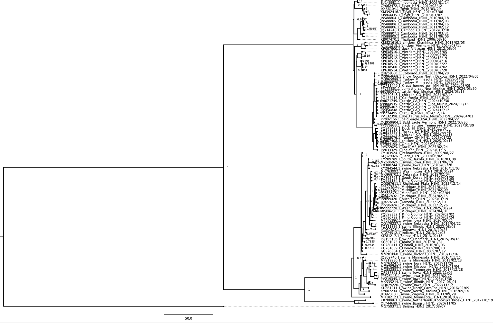
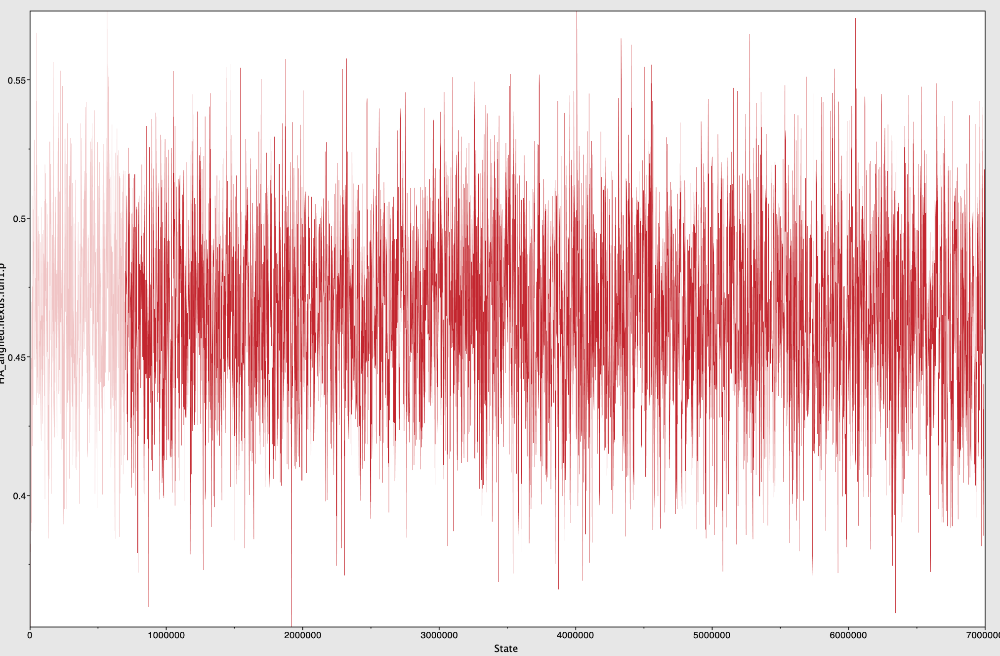
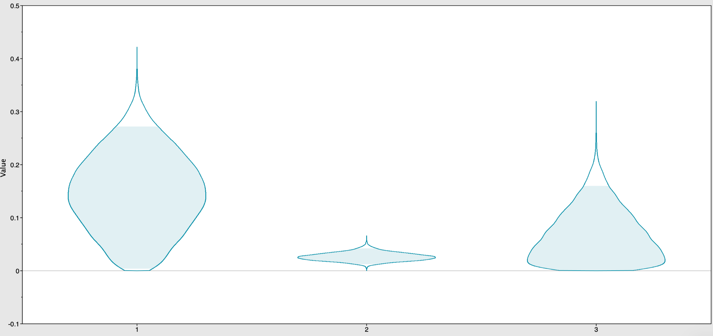

::: {.panel-tabset}

## Article

Influenza A carries eight RNA segments. Segment 4 encodes haemagglutinin, the surface
glycoprotein that binds sialic acid on the host cell and mediates entry. The gene mutates
fast enough that its sequence carries a record of when lineages split, and the sampling
dates attached to each sequence let that record be read in years rather than in
substitutions.

The dataset is 101 haemagglutinin coding sequences from GenBank — humans, birds, swine and
other hosts — aligned to 1778 bp and rooted on a single H3N2 outgroup. A second dataset of
86 PB1 sequences is used as a control.

```{=html}
<figure>
  
  <figcaption>The dated consensus tree from BEAST2. The scale is in years.</figcaption>
</figure>
```

## Divergence

Node heights come from the maximum clade credibility tree with 95% highest posterior
density intervals, in years before the most recent sampling date.

H5 lands at 24.84 years, interval 23.56 – 26.17, which puts the common ancestor of that
clade in the 1990s — where the highly pathogenic avian lineage is first recorded, H5N1 in
1996. H1 lands at 74.42, interval 66.19 – 84.12, in the middle of the twentieth century,
matching the emergence of classical swine and human H1N1. The two clades split 157.5 years
back, interval 136.21 – 177.38, deeper than either, and consistent with the older
literature placing the major HA subtypes several centuries back.

The widths are worth reading before the point estimates. H5 is bounded to about two and a
half years; H1 is bounded to eighteen; the H1/H5 split to forty. A tighter posterior on the
shallow node is what the dating model predicts — more branch lengths constrain a recent
split more than an ancient one — and it is the reason the H5 date can be checked against a
historical record and the split cannot.

## Convergence

Two independent runs per dataset. MrBayes converged cleanly: across forty tracked
parameters the potential scale reduction factor ran 0.9999 to 1.0020, and effective sample
sizes ran 783 to 4864, with the fifteen invariant-site proportions at 2525 to 4528.

BEAST2 did not converge to the same standard, and the gap is not evenly distributed.

```{=html}
<figure>
  
  <figcaption>Transition rate r(A↔G) on the PB1 dataset, one of the parameters that mixes
  well.</figcaption>
</figure>
```

On the HA log, 901 samples survive a 10% burn-in from 1001 retained. Recomputing the
effective sample size on those samples separates the parameters cleanly:

| parameter | ESS |
|---|---|
| likelihood | 899 |
| clock rate, three partitions | 623 – 780 |
| tree height | 463 |
| posterior | 25 |
| prior | 21 |
| substitution rates, all twelve | 3 – 7 |

```{=html}
<figure>
  
  <figcaption>Posterior of the invariant-site fraction, one violin per codon position. Position
  1 sits near 0.17, position 2 near 0.02, position 3 near 0.16. These are the fifteen
  proportions with effective sample sizes of 2525 to 4528, which is why they can be read off
  the figure at all.</figcaption>
</figure>
```

The tree and the clock are sampled well enough to date nodes. The substitution rates are
not — an effective sample size of three to seven means those posteriors are unconverged in
any meaningful sense, and any statement about relative substitution rates under this model
should be treated as provisional. The joint posterior inherits the worst of its components,
which is why it sits at 25 while the likelihood sits at 899.

The most likely cause is the codon partition. Three partitions, each with its own
substitution matrix, put the same 1778 sites behind three times as many parameters. The
run was 5 million generations with 25% discarded as burn-in, and that was not enough for
this parameterisation.

I also ran BEAST2 under GTR + Γ rather than GTR + I + Γ, because BEAUti flagged the
invariant-sites parameter and I dropped it under time pressure without working through the
consequence. That rules out a direct comparison of invariant-site estimates between the two
methods, and I did not notice until both analyses were finished.

## Clock

The three partitions carry different clock rates, and the posterior means separate them
well past their spread:

| codon position | rate, substitutions per site per year | sd |
|---|---|---|
| 1 | 0.00182 | 0.00017 |
| 2 | 0.00874 | 0.00042 |
| 3 | 0.00276 | 0.00021 |

Partition 2 evolves at 4.8 times the rate of partition 1. Each mean sits more than eight
standard deviations from its neighbour, so this is not posterior noise — the well-mixed
clock rate is the one parameter the run can be trusted on.

That the second codon position is the fast one is the odd result. Third positions are
normally closest to neutral and least constrained, and here they are three times slower than
the middle position. With substitution rates at an effective sample size of three, the
honest reading is that the ordering is not established by this run. It is a result that
would need a longer chain, or a simpler partition, before it could be reported as anything
other than a curiosity.

## Code

MrBayes and BEAST2 are command-line programs, not libraries. The analysis is the alignments
and the configuration files they were handed, plus the Python that cleaned the headers
between steps, so that is what is here.

```{=html}
<ul class="filelist">
  <li><a href="outsides/code/HA_alignment.nexus">HA_alignment.nexus</a>
      <span>101 sequences, 1778 bp, three codon partitions</span></li>
  <li><a href="outsides/code/PB1_alignment.nexus">PB1_alignment.nexus</a>
      <span>86 sequences, 2274 bp, the control dataset</span></li>
  <li><a href="outsides/code/HARun1.xml">HARun1.xml</a>
      <span>the BEAST2 run: GTR + Γ, strict clock, constant-size coalescent, three partitions</span></li>
  <li><a href="outsides/code/fastadatefixforbeati.py">fastadatefixforbeati.py</a>
      <span>rewrites <code>2017_08_07</code> to <code>2017-08-07</code> in the headers</span></li>
  <li><a href="outsides/code/beautidate2.py">beautidate2.py</a>
      <span>appends the date after a pipe, the first format BEAST2 accepted</span></li>
  <li><a href="outsides/code/beautidate3.py">beautidate3.py</a>
      <span>swaps the dashes for slashes, the format it finally parsed</span></li>
  <li><a href="outsides/code/dataset1rename.py">dataset1rename.py</a>
      <span>host_location_year_month_day_genotype, so a tree tip says what it is</span></li>
  <li><a href="outsides/code/trimstopcodon.py">trimstopcodon.py</a>
      <span>drops the terminal stop codon before alignment</span></li>
  <li><a href="diagnostics.py">diagnostics.py</a>
      <span>reads the <code>.pstat</code> and <code>.log</code> and recomputes the tables above</span></li>
  <li><a href="outsides/code/tree_comparison_summary.txt">tree_comparison_summary.txt</a>
      <span>Robinson-Foulds distance between the MrBayes and BEAST2 topologies, 172 raw</span></li>
</ul>
```

One of those numbers deserves saying out loud. The Robinson-Foulds distance between the two
consensus trees is 172 raw, 0.9773 normalised, on 100 matching tips. Two methods given the
same alignment agreed on almost none of their splits. That is a large disagreement and it is
the strongest argument on this page for not quoting node ages from the BEAST2 run without
the caveats above.
