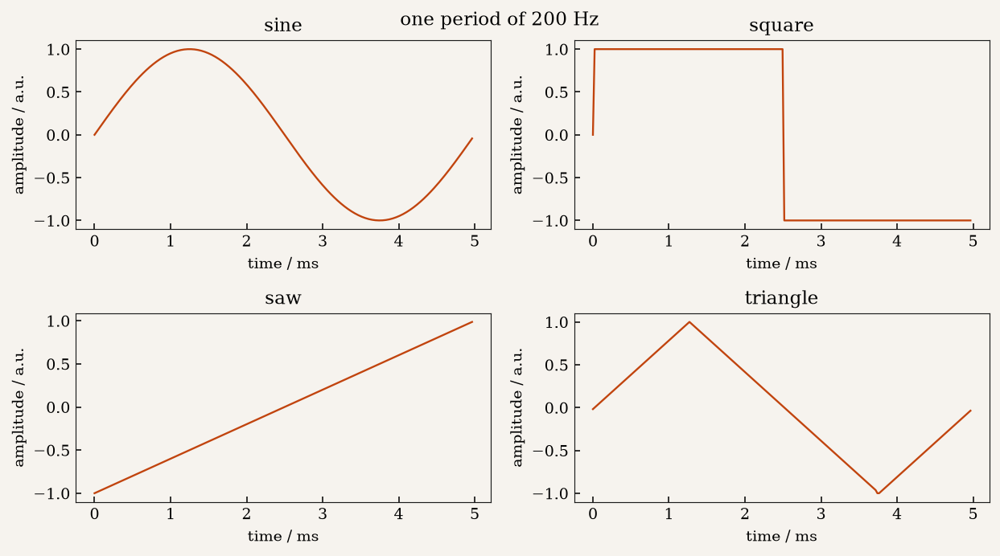
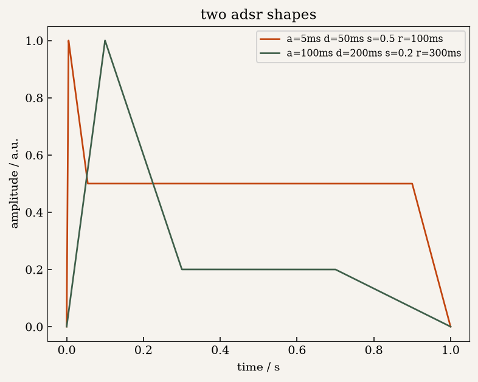
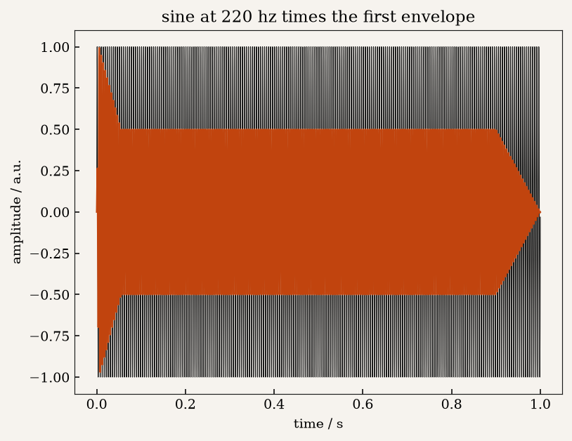
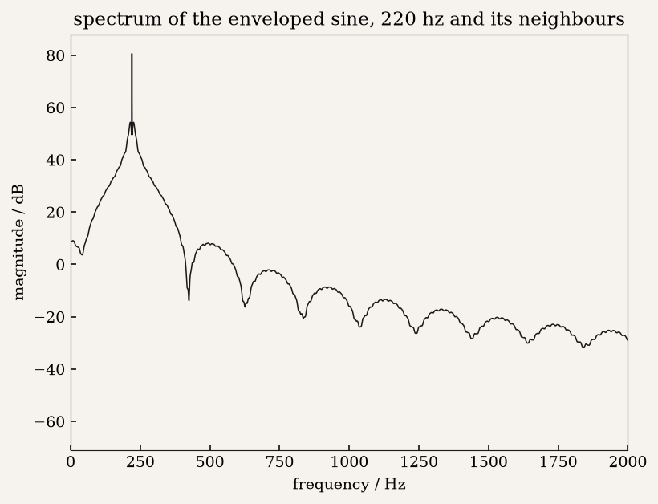
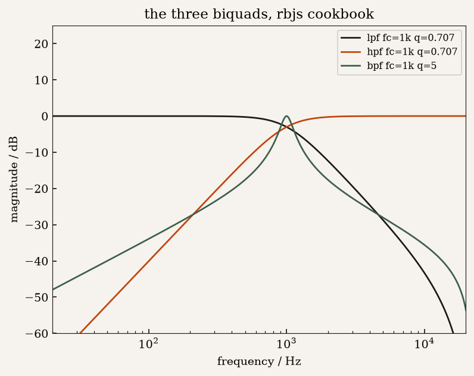
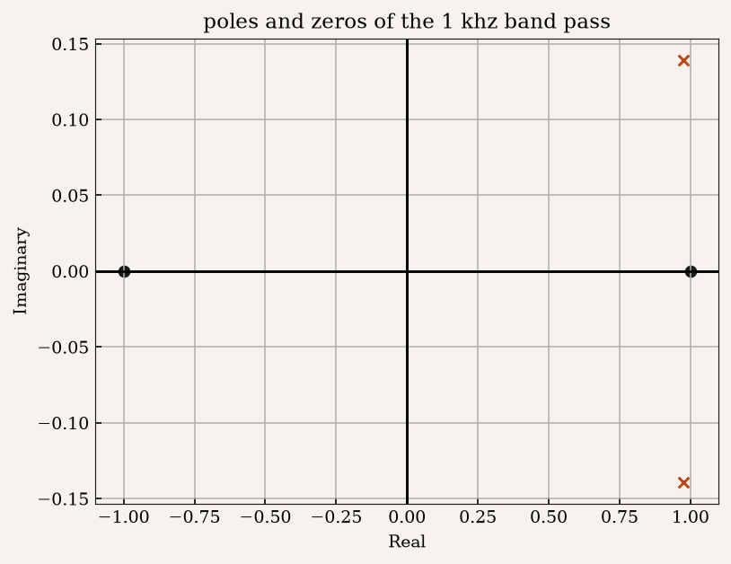
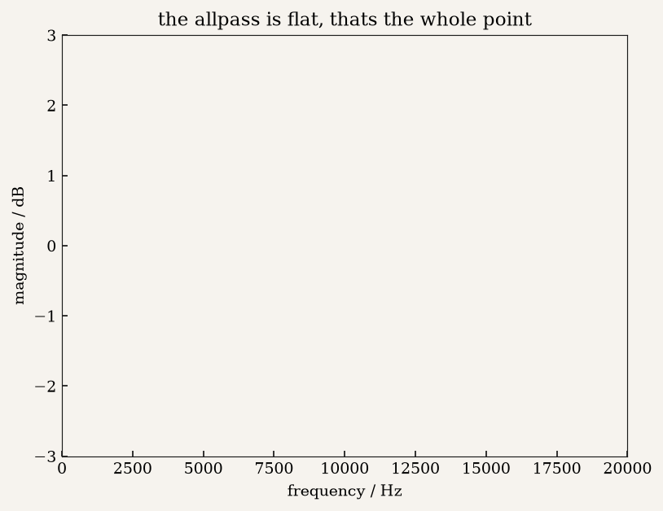
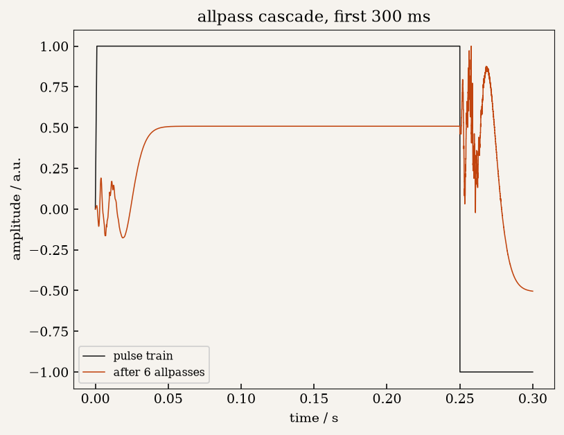
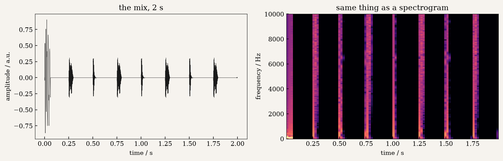

::: {.panel-tabset}

## Article

A synthesiser is four ideas stacked on top of each other: an oscillator that repeats, an
envelope that shapes, a filter that removes, and a delay that offsets. None of them need a
library. Each one here is a difference equation or a closed-form expression, and every
figure below is the output of the code that implements it.

```{=html}
<figure>
  
  <figcaption>One period of 200 Hz, sampled at 44.1 kHz — 220.5 samples, which is why the
  square wave changes value partway through a sample and the corners are not identical.</figcaption>
</figure>
```

Sine and square are one line each. The saw is the fractional part of the running phase,
$2((ft + \phi/2\pi) \bmod 1) - 1$. The triangle is the integral of the square, which is a
cumulative sum — but the integral of a square sits flat for a quarter period before the
square goes positive, so each period is rotated by a quarter and the shapes line up at
$t = 0$. Both are three lines of numpy.

```{=html}
<figure>
  
  <figcaption>Two envelopes: a percussive one with a 5 ms attack, and a slow pad-shaped one.</figcaption>
</figure>
```

The envelope is three straight lines and a hold, which is one `np.linspace` per segment and
no reason to be cleverer. The attack is 5 ms because anything shorter clicks. Multiplying a
sine by it buys the whole difference between a tone and a note:

```{=html}
<figure>
  
  <figcaption>A 220 Hz sine, and the same sine multiplied by the percussive envelope.</figcaption>
</figure>
```

And multiplying by an envelope is multiplying by a signal, so in frequency it is a
convolution — sidebands appear around the carrier at the envelope's own repetition rate,
and they fall off as the envelope gets more abrupt.

```{=html}
<figure>
  
  <figcaption>The spectrum of the enveloped sine. The carrier is at 220 Hz and the
  sidebands sit at its neighbours, spaced by the envelope rate.</figcaption>
</figure>
```

## Filters

A biquad is five numerator coefficients and three denominator coefficients and a loop over
the signal. `scipy.signal.lfilter` runs the loop; the coefficients are worth writing out by
hand, because placing poles and zeros is the part that teaches anything. These are the RBJ
audio EQ cookbook forms — $\omega_0 = 2\pi f_c / f_s$, $\alpha = \sin\omega_0 / 2Q$ — and a
band-pass is the low-pass and high-pass combined into one section rather than two cascaded.

```{=html}
<figure>
  
  <figcaption>The three biquads at a common 1 kHz corner, so only the shape differs. The
  band-pass uses Q = 5.</figcaption>
</figure>
```

The pole-zero plot is the same object from the other side. The zeros sit on the unit circle,
which is what puts notches in the response, and the poles sit just inside it at the band
centre — close enough to the circle to lift the response over a narrow band, close enough to
the real axis to keep it from ringing forever.

```{=html}
<figure>
  
  <figcaption>Poles and zeros of the 1 kHz band-pass, in the z-plane. Zeros are crosses, poles
  are circles; the axes are the unit circle's real and imaginary parts.</figcaption>
</figure>
```

## All-passes and a comb

An all-pass does nothing to the magnitude. It only shifts phase, and the magnitude is flat
by construction: put the zeros anywhere, put the poles at their reciprocal conjugates, and
`np.poly` gives you coefficients that cannot change the magnitude whatever you choose.

```{=html}
<figure>
  
  <figcaption>A fifth-order all-pass, flat to three decimal places from DC to Nyquist.</figcaption>
</figure>
```

Flat to three decimals everywhere, which is the whole point of the construction and also
the reason a single all-pass is useless on its own — a filter that changes nothing is not a
filter. It is only useful once you add it back to the original. The delayed version
cancels at frequencies where it lands in antiphase, and the first notch falls at
$f_s / d$ — so a delay of 84 samples at 44.1 kHz puts notches every 525 Hz, which is the
comb. Make the delay an all-pass instead of a pure delay and the notches spread out
unevenly, which is what a phaser does and a flanger does not.

```{=html}
<figure>
  
  <figcaption>A pulse train through six all-passes with delays of 40, 47, 54, 61, 68 and 75
  samples. The magnitudes are flat; the waveform is not, because the phase is not.</figcaption>
</figure>
```

## The beat

Kick, hat and phaser summed. The kick is a sine sliding 110 → 45 Hz over 60 ms with a saw
layer for grit, under a 1 ms attack and a 150 ms decay, so it is finished before the next
hit at 120 bpm. The hat is noise through a 6 kHz high-pass, gated to 50 ms, which is long
enough to read as a tick and short of a snare.

```{=html}
<figure>
  
  <figcaption>The mix in the time domain and in frequency. The vertical stripes are the kick
  hits at 0, 0.5, 1.0 and 1.5 s; the broadband energy above 6 kHz is the hat, offset into
  the gaps between them.</figcaption>
</figure>
```

```{=html}
<audio controls src="signal/synth.wav" style="width:100%; margin: 1.2rem 0"></audio>
<div class="audio-note">The rendered mix, 2.0 s, 88,200 samples. Kick at 0, 0.5, 1.0 and
1.5 s, hat in the gaps, phaser on top.</div>
```

A last check the notebook runs on itself, which is worth keeping: convolving the pulse train
with the all-pass impulse response and multiplying their FFTs give a maximum difference of
0.0886, not zero. That is not a bug. The FFT convolution is circular, so the tail of the
linear convolution wraps around to the front. The two agree everywhere except where the
signal is discontinuous, which is exactly where a wrapped tail lands.

## Code

`rerun_notebook.py` executes this notebook's cells unmodified and captures the eleven
figures. The code itself is in the notebook, not here — the page shows what it produced.
