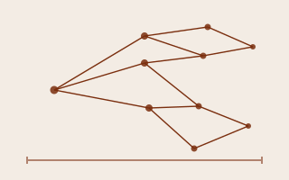
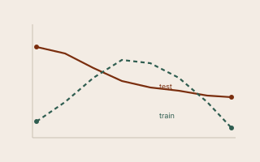
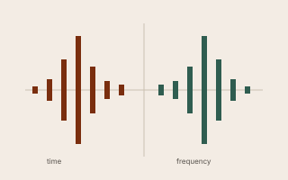
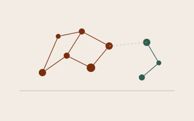

```{=html}
<div class="work">

  <article class="piece">
    <a class="piece-link" href="articles/outsides.html">
      <div class="thumb"></div>
      <div class="body">
        <div class="kicker">Bayesian inference</div>
        <h3 class="piece-title">What the outsides of a virus tell you</h3>
        <p class="piece-desc">Dating the divergence of influenza A subtypes from 101 dated haemagglutinin sequences.</p>
      </div>
    </a>
  </article>

  <article class="piece">
    <a class="piece-link" href="articles/models.html">
      <div class="thumb"></div>
      <div class="body">
        <div class="kicker">Machine learning</div>
        <h3 class="piece-title">Choosing a model when the data is noisy</h3>
        <p class="piece-desc">A regularisation sweep and a two-layer cross-validation where the better model wins by 0.024 alcohol units, and the confidence interval barely clears zero.</p>
      </div>
    </a>
  </article>

  <article class="piece">
    <a class="piece-link" href="articles/signal.html">
      <div class="thumb"></div>
      <div class="body">
        <div class="kicker">Signal processing</div>
        <h3 class="piece-title">Reverberation is a filter you can hear</h3>
        <p class="piece-desc">Oscillators, envelopes, biquads and an all-pass cascade built from the difference equations, with the rendered audio.</p>
      </div>
    </a>
  </article>

  <article class="piece">
    <a class="piece-link" href="articles/systems.html">
      <div class="thumb"></div>
      <div class="body">
        <div class="kicker">Systems biology</div>
        <h3 class="piece-title">Differential expression, and what it misses</h3>
        <p class="piece-desc">TCGA liver cancer in R: 5,671 genes separate tumour from normal, and the isoform-level analysis disagrees with them on more pathways than it agrees.</p>
      </div>
    </a>
  </article>

</div>
```
